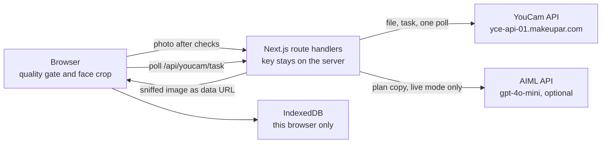

# MEHFIL

MEHFIL is a wedding-week look planner for South Asian celebrations. One portrait becomes Mehndi, Baraat, and Walima: the outfit and the grooming in a single frame, plus an event-day skin goal and a shoppable shade list with no brand names.

The groom week ships with a real YouCam run. The subject is Muhammad Asim, who consented. Bride and guest weeks are labeled placeholder drawings until a consented live run replaces them.

## The problem

A South Asian wedding is not one outfit. It is a week. Mehndi, Baraat, and Walima ask for different clothes and different makeup, and the people buying those clothes often cannot try them on. Diaspora shoppers order from boutiques in Lahore, Karachi, and Delhi. A return across a border is slow or impossible, and the makeup trial happens somewhere else, on a different day, against a different photograph.

India’s wedding industry is about **$130 billion**, with **8–10 million weddings a year** and a calendar of several events, according to a Jefferies estimate reported by [Business of Fashion](https://www.businessoffashion.com/articles/global-markets/how-global-brands-tap-indias-130-billion-wedding-market/) (17 September 2024). The spend is real. The try-on is not.

MEHFIL does not tell someone what to buy. The outfits are already chosen. It shows those outfits, and a grooming look that belongs with them, on the same face.

## What each YouCam API does

Server: `https://yce-api-01.makeupar.com`. Auth is `Authorization: Bearer <YOUCAM_API_KEY>` on the server only. The old RSA client-auth step is not used.

| API | Why it is here |
| --- | --- |
| **Skin Analysis** `POST /s2s/v2.0/task/skin-analysis` | Standard quality, seven concerns: oiliness, redness, dark circles, texture, pores, acne, skin type. On the live groom run the overall score was 89, skin age 29, and dark circles (display 63, raw 45.55) were the only score that asked for attention. Cost: 12 units for 5–8 SD concerns. |
| **Facial Color Tones** `POST /s2s/v2.0/task/skin-tone-analysis` | Skin, lip, eye, and brow hex values. The live skin hex is `#805E46`. The hair color name is not shown: on this run the analyzer said Auburn for black hair. Cost: 20 units, once. |
| **Clothes VTO v4** `POST /s2s/v2.0/task/cloth-v4` | The full portrait plus a garment image. Chest-up photos use `upper_body`. A full-length photo can use `full_body` for a lehenga or a full sherwani. Categories: `full_body`, `lower_body`, `upper_body`, `shoes`, `auto`, `outer`. Cost: 2 units. |
| **Makeup VTO** `POST /s2s/v2.0/task/makeup-vto` | `{ src_file_id, effects, version: "1.0" }`. `skin_smooth` is always sent, because omitting it silently applies 50. Foundation carries color, color intensity, glow, and coverage. Concealer carries color, color intensity, under-eye intensity, and coverage. Cost: 1 unit. |
| **Skin Simulation** `POST /s2s/v2.0/task/skin-simulation` | A cosmetic event-day preview. Analysis names are mapped onto simulation fields: `dark_circle_v2` → `dark_circle`, `pore` → `pores`, `age_spot` → `spots`, `eye_bag` → `eye_bags`. The planner does not send `oiliness` on a fresh plan, because that scale adds shine at 1.0. The shipped groom preview is the recorded render (`dark_circle` 0.5, `texture` 0.3, `pores` 0.3, `oiliness` 0.4) and the slider is zoomed to the eyes, because the change is subtle. Cost: 4 units for 1–4 fields. |

Skin analysis, color tones, and simulation need a face crop where the face fills about 60% of the width. Without it they return `error_face_position_too_small`. The browser crops with the built-in face detector or MediaPipe Face Detector before those calls. Clothes try-on uses the full photo.

A result is fed into the next task by uploading it as a new file. Result URLs expire after about two hours, and makeup and simulation often return PNG bytes behind a `.jpg` name, so the server sniffs the bytes and hands the browser a data URL. The browser keeps the session in IndexedDB. No Blob store is required on the free tier.

The planner chooses the order:

- **Groom, or a guest dressing as a man.** One grooming look, then each outfit. Makeup runs once. Cheaper when the same grooming is reused, and it is what the live groom test compared as order B.
- **Bride, or a guest dressing as a woman.** Outfit first, then makeup on that result, a different recipe per function. The live test found this order kept more real skin detail (order A on the Baraat sherwani).

The Baraat card in the groom demo can flip between the two orders. Both images are from the live run.

## Architecture



Each YouCam job takes about 10–20 seconds. The browser polls a status route every 3 seconds. A single serverless call never waits for the job, so a 10 second function limit is not the polling loop.

## The agent

1. Read the skin scores and the tone hex values. Only those numbers, plus hues and ITA° computed from them, may appear in the copy.
2. Choose the chain from the role.
3. Build a Makeup VTO effect list. Grooming stays near the measured lip. Bridal lips follow the garment. Night is deeper than day.
4. Check lip against garment. A clash is corrected once, then the loop stops.
5. Write a generic shade list and a cosmetic prep list. No brand names. No diagnostic language.
6. If `AIML_API_KEY` is set and the mode is live, gpt-4o-mini may rewrite the notes. Invented numbers or banned claims are dropped and the rule-based copy stays. Demo mode does not call the model, so it runs with no keys.

## Units

A full groom week is 12 + 20 + 1 + 2×3 + 4 = **43** units before a replan. A bride week is 12 + 20 + 3×2 + 3×1 + 4 = **45**. The live groom session that produced the shipped images used **46** units (balance 1,954 → 1,908), including both orders on Baraat and one failed tone call on the uncropped photo, which cost nothing.

Failed tasks are not charged by YouCam. MEHFIL releases the unused part of a reservation when a run finishes.

| Guard | Default |
| --- | --- |
| Demo mode | On. Zero units. |
| Live runs per IP per UTC day | 2 (`LIVE_RUNS_PER_IP`) |
| Daily unit ceiling | 150 (`DAILY_UNIT_CAP`) |
| Reserved per run | 60 (`SESSION_UNIT_BUDGET`) |
| Analysis cache | SHA-256 of the image, in memory on the server and in the browser |

Past the cap, the API tells the page to fall back to the demo. Without Upstash, the ledger is the server instance plus the best effort of that process. Set `UPSTASH_REDIS_REST_URL` and `UPSTASH_REDIS_REST_TOKEN` to share it across instances.

Do not call YouCam from tests. Tests use the manifests and mocks.

## Demo assets

`public/demo/<scenario>/manifest.json` is the contract. `public/demo/groom/live-run.json` is the lab note from the live session and is not what the app reads.

```json
{
  "id": "groom",
  "title": "Groom week",
  "placeholder": false,
  "subject": "Muhammad Asim (consented)",
  "role": "groom",
  "presentation": "man",
  "framing": "chest-up",
  "selfie": "/demo/groom/input/asim_original.jpg",
  "faceCrop": "/demo/groom/input/asim_face_crop_skin.jpg",
  "simulationImage": "/demo/groom/simulation/event_day_goal.png",
  "groomingImage": "/demo/groom/makeup/orderB_step1_makeup_only.png",
  "eyeFocus": { "x": 50, "y": 42, "scale": 1.85 },
  "simulation": { "dark_circle": 0.5, "oiliness": 0.4, "pores": 0.3, "texture": 0.3 },
  "skin": { "output": [{ "type": "dark_circle_v2", "ui_score": 63, "raw_score": 45.55 }] },
  "tones": { "skin_color": "#805E46", "lip_color": "#936769", "hair_color_name": "Auburn" },
  "masks": { "dark_circle_v2": "/demo/groom/skin/mask_dark_circle_v2.jpg" },
  "events": [{
    "id": "mehndi",
    "name": "Mehndi",
    "date": "2026-11-14",
    "timeOfDay": "evening",
    "venue": "Family courtyard",
    "outfitId": "groom-mehndi-kurta",
    "tryOnImage": "/demo/groom/tryon/cloth_mehndi_kurta_mustard.jpg",
    "beforeImage": "/demo/groom/input/asim_original.jpg",
    "alternateTryOn": null,
    "alternateLabel": null
  }],
  "preferManifestPlan": false,
  "plan": null
}
```

`skin.output` is the flat YouCam list. `all` and `skin_age` use `score`. `skin_type` appears three times, with `region` of `whole`, `t_zone`, and `u_zone`. `hair_color_name` may be present and is not rendered. `plan` stays null: the app rebuilds it from the scores. Outfit ids must exist in `src/lib/outfits.ts`.

Replace a file and keep the path, or change the path in the manifest. Set `placeholder` to false only when the images are a real, consented run.

## Sample outfits

| Images | Source |
| --- | --- |
| `public/demo/groom/garments/*.jpg` | AI-generated product shots made for this project. No logos, no faces, free to use. |
| `public/demo/groom/tryon` and `makeup` and `simulation` | Outputs of the YouCam API on a consented portrait. |
| `public/outfits/*.svg` and `public/demo/bride`, `public/demo/guest` | Original vector drawings made for MEHFIL. They are marked PLACEHOLDER. Not photographs. |

## Setup

```bash
npm install
npm test
npm run lint
npm run typecheck
npm run build
npm run dev
```

Demo mode needs no environment variables. Copy `.env.example` to `.env.local` and fill names only when you want a live run.

| Variable | Required | Purpose |
| --- | --- | --- |
| `YOUCAM_API_KEY` | Live only | Server-side Bearer token. Never `NEXT_PUBLIC_`. |
| `AIML_API_KEY` | No | Optional copy pass. Model defaults to `gpt-4o-mini`. |
| `AIML_MODEL` | No | Override the model. |
| `AIML_BASE_URL` | No | Default `https://api.aimlapi.com/v1`. |
| `DAILY_UNIT_CAP` | No | Default 150. |
| `LIVE_RUNS_PER_IP` | No | Default 2. |
| `SESSION_UNIT_BUDGET` | No | Default 60. |
| `UPSTASH_REDIS_REST_URL` | No | Shared unit ledger. |
| `UPSTASH_REDIS_REST_TOKEN` | No | Shared unit ledger. |
| `IP_HASH_SALT` | No | Salt for visitor hashes. |

On Vercel, set the framework to Next.js, Node 20 or newer, install `npm install`, build `npm run build`. Put the variables above in Production and Preview. Do not mark the keys as exposed to the browser. Function duration stays at the default 10 seconds. No Blob store, no database.

### Demo and live

The site opens in demo mode. “Open the groom week” spends nothing. “Use my photo” is live: the browser checks the file, crops the face, and the server refuses the run when the key is missing, the IP has used its two runs, or the daily ceiling would break. The page then loads the demo and says why.

## Privacy

There is no account. An uploaded photo is held only for the YouCam request and is not written to a database. Results live in IndexedDB on the device. The app does not infer ethnicity or health. Copy is cosmetic. Skin age is shown as YouCam’s score, not as a judgment.

The groom portrait is a consented static asset. It is not an upload.

## Scripts

`npm test` covers the planner (including the one-pass replan and the citation check), the unit guard, and the demo path. The demo test fails if a groom image is missing or if planning touches the network.

## License

[MIT](LICENSE).
